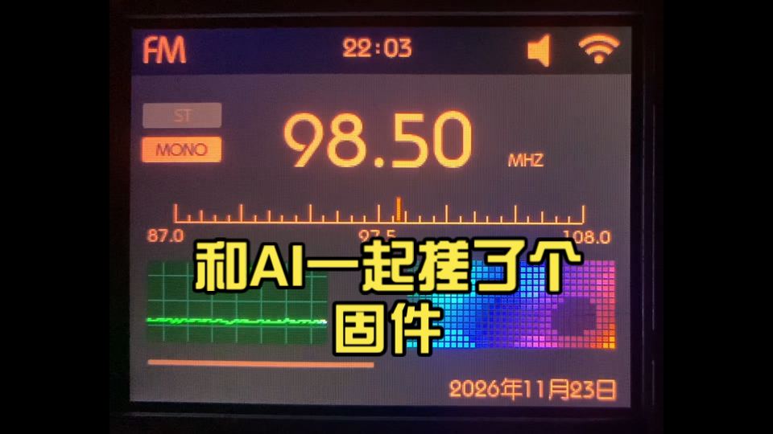

# 带鱼固件 · TEF6686 双固件收音机（ESP32-S3）

**带鱼固件**是给 STS-6686N 这套板子做的 TEF6686 收音机固件：ESP32-S3 主控、NXP TEF6686 调谐、ST7789 屏幕、
触控/双编码器，一套固件里塞了 UV 表盘、中文界面和网页控制台。

板子上跑两个固件，开机有一个选择页：**带鱼固件** 和 **YoRadio**（开源网络电台，原样打包进镜像）。

**本仓库只发布成品固件（bin），不提供源码。**

[](https://www.bilibili.com/video/BV1wjyXzEEbz/)

▶ 视频：**[ESP32 收音机，和 AI 一起搓了个固件](https://www.bilibili.com/video/BV1wjyXzEEbz/)**（B 站）

---

## 硬件

| 部分 | 型号 |
|---|---|
| 主控 | ESP32-S3-WROOM-1 **N16R8**（16MB Flash / 8MB PSRAM） |
| 调谐 | NXP **TEF6686**（FM / MW / SW，I²S 数字音频输出） |
| 屏幕 | **ST7789** 320×240 SPI |
| 存储 | 内部 16MB Flash，双 app 分区 |
| 交互 | 双旋转编码器 + 按键 + 电容触摸（可选） |

## 带鱼固件有什么

- **LVGL 8.3 自绘界面**：320×240 中文 UI、开机动画、表盘与 VU 指针、局部刷屏
- **TEF6686 全功能**：FM / MW / SW 切换、自动扫台存台（EEPROM 持久化）、带宽、iMS 多径抑制、
  通道均衡 EQ、软静音、去加重 50 µs
- **网页控制台**（板子自己起 HTTP 服务，手机/电脑浏览器直接开）
  - 实时频谱、频率/台名/信号状态、存台、音量、主题
  - **iOS 风格滑动开关**控制芯片 iMS / EQ
  - **网页听音**：板子把 TEF6686 的 I²S 数字流重采样成 32 kHz 单声道 PCM，走 HTTP 推给浏览器；
    听音期间自动关板载功放，关网页 / 断线自动交回，切台不会漏音
- **WiFi 配网**：无人值守 AP（`STS6686-AP`），DNS 劫持自动跳配网页
- 静音 / 音量 / 亮度 / 屏保 / 息屏 / 主题全部持久化

## 刷机

附件是**已合并的整机镜像**（8MB，含 bootloader、分区表、选择器、两套固件）。
镜像里 NVS 是空白 —— 不含任何 WiFi、存台和个人配置，刷完自己配网。

```
esptool.py --chip esp32s3 --port <你的串口> --baud 921600 \
  write_flash -z --flash_mode dio --flash_freq 80m --flash_size 16MB \
  0x0 daiyu6686_fw_20261123.bin
```

Windows 用 ESP32 Flash Download Tool 也行：地址 `0x0`，`DIO`，`80MHz`，`16MB`。

刷完第一次开机会停在选择页，自己选「带鱼固件」或「YoRadio」。

### 配网

1. 板子开热点 `STS6686-AP`（无密码），手机连上
2. 浏览器随便开个网址 → 自动跳到配网页；或直接访问 `192.168.4.1`
3. 填 WiFi 名 / 密码，板子重启进 STA 模式
4. 浏览器打开板子 IP（`http://<IP>/`）就是网页控制台

### 说明

- 只适配上面那张板子，不是给原厂机的补丁
- 网页听音走 `8081` 端口（`audio/L16;rate=32000;channels=1`），局域网直连，不外传
- 屏幕中文是裁剪子集字库，只覆盖界面用到的字

## 基于这些开源项目

带鱼固件是在 PE5PVB 的 TEF6686_ESP32 基础上二次开发的，驱动层和部分底层逻辑来自它；
UI、屏幕、网页控制台、双固件选择器是重做的。谢谢各位作者：

| 项目 | 用途 | 许可 |
|---|---|---|
| [PE5PVB/TEF6686_ESP32](https://github.com/PE5PVB/TEF6686_ESP32) | 带鱼固件的底子：TEF6686 驱动与 Tuner 底层 | GPLv3 |
| [YoRadio](https://github.com/e2002/yoradio) | 第二个固件（网络电台），原样打包 | GPLv3 |
| [LVGL](https://github.com/lvgl/lvgl) 8.3 | 图形界面 | MIT |
| [TFT_eSPI](https://github.com/Bodmer/TFT_eSPI) | ST7789 显示驱动 | MIT / FreeBSD |
| [ESP32-audioI2S](https://github.com/schreibfaul1/ESP32-audioI2S) | YoRadio 的音频解码 | GPLv3 |
| [ESP32Time](https://github.com/fbiego/ESP32Time) | RTC | MIT |
| [Time](https://github.com/PaulStoffregen/Time) | 时间库 | LGPL-2.1 |
| [lv_font_conv](https://github.com/lvgl/lv_font_conv) | 子集字库生成 | MIT |

## 许可

- 固件二进制：GPLv3（衍生自 GPLv3 项目，按 GPLv3 分发）
- 本 README：CC BY-NC 4.0

刷坏了自己救，不提供技术支持。
